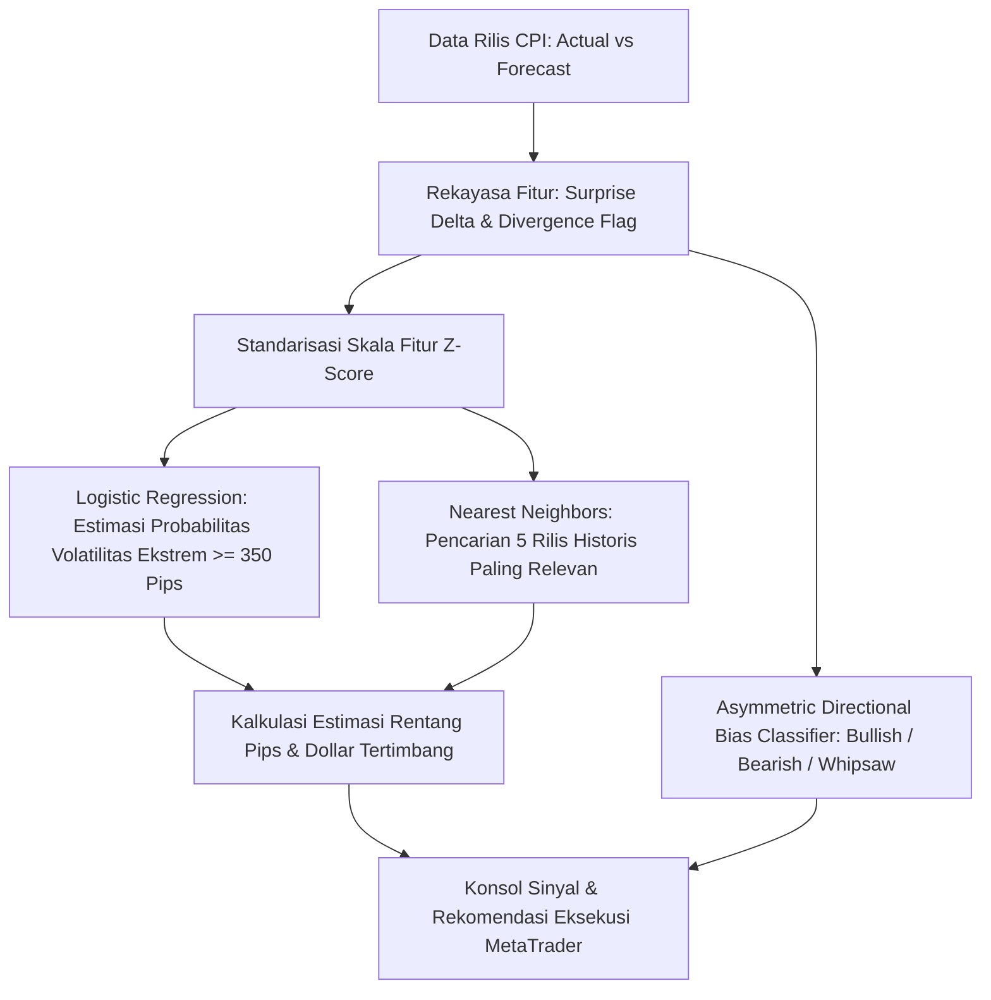

# 📈 CPI Macro Surprise & Tail Volatility Forecasting: XAU/USD (Gold)

[](https://www.python.org/downloads/)
[](https://opensource.org/licenses/MIT)
[](https://finance.yahoo.com/quote/GC%3DF)
[]()
[]()

> **Framework kuantitatif institusional untuk memprediksi probabilitas risiko ekor volatilitas (*tail volatility risk*) ≥ 350 pips ($35.00 USD) dan bias arah asimetris pada instrumen Emas (XAU/USD) berdasarkan analisis deviasi kejutan makroekonomi rilis CPI AS (*Actual vs Forecast*).**

---

## 📌 Daftar Isi
- [1. Latar Belakang & Tesis Kuantitatif](#1-latar-belakang--tesis-kuantitatif)
- [2. Arsitektur & Pipeline Sistem](#2-arsitektur--pipeline-sistem)
- [3. Hasil Validasi Statistik Formal](#3-hasil-validasi-statistik-formal)
- [4. Struktur Direktori Proyek](#4-struktur-direktori-proyek)
- [5. Panduan Instalasi](#5-panduan-instalasi)
- [6. Panduan Menjalankan Program](#6-panduan-menjalankan-program)
- [7. SOP Eksekusi Market (MetaTrader 4 / 5 Playbook)](#7-sop-eksekusi-market-metatrader-4--5-playbook)

---

## 1. Latar Belakang & Tesis Kuantitatif

Rilis data inflasi *Consumer Price Index* (CPI) oleh *U.S. Bureau of Labor Statistics* (BLS) setiap bulan pada pukul 08:30 ET merupakan katalis penggerak likuiditas paling volatil bagi instrumen Emas (XAU/USD).

### Mengapa Model Arah Linear Ritel Kerap Gagal?
1. **Jebakan Likuiditas (*Liquidity Sweeps / Whipsaw*)**: Dalam 1 hingga 5 menit pertama, algoritma frekuensi tinggi (HFT) sering memicu lonjakan dua arah untuk menyapu *Stop Loss* trader ritel sebelum tren utama terbentuk.
2. **Divergensi Antar-Komponen**: Ketika angka *Headline CPI YoY* turun namun *Core CPI MoM* naik, pasar mengalami disonansi arah sementara yang memicu ekor *candle* panjang.

### 💡 Solusi: Pemodelan Vektor Kejutan Makro (*Macro Surprise Vector*)
Pasar tidak bereaksi terhadap nilai absolut inflasi, melainkan terhadap **seberapa jauh angka rilis meleset dari konsensus analis (*Consensus Forecast*)**:

```text
Surprise_Core = Core_CPI_MoM_Actual - Core_CPI_MoM_Forecast
Surprise_YoY  = Headline_CPI_YoY_Actual - Headline_CPI_YoY_Forecast
Volatilitas   = (High_CPI - Low_CPI) × 10 (Pips)
```

* **Core CPI MoM adalah Penggerak Utama**: Komponen inti yang mengecualikan makanan dan energi memiliki korelasi tertinggi terhadap ekspektasi suku bunga Federal Reserve.
* **Asymmetric Directional Skew**: Deviasi Core CPI ≥ +0.1% secara konsisten memicu tekanan jual (*Bearish Dump*), sedangkan deviasi ≤ -0.1% memicu lonjakan beli (*Bullish Surge*).

---

## 2. Arsitektur & Pipeline Sistem



---

## 3. Hasil Validasi Statistik Formal

Pengujian dilakukan secara ketat pada data *out-of-sample* (2025–2026, $N=20$ rilis bulanan) setelah model dilatih pada periode 2020–2024 ($N=60$ rilis bulanan):

| Metrik Evaluasi | Nilai | Penjelasan Kuantitatif |
| :--- | :---: | :--- |
| **Precision (Deteksi Ekstrem)** | **100.0%** | Setiap kali model memicu alarm bahaya, pasar terbukti meledak ≥ 350 pips. |
| **Recall (Sensitivitas Ekstrem)** | **57.9%** | Proporsi kondisi pasar ekstrem yang berhasil ditangkap oleh ambang batas konservatif. |
| **F1-Score** | **0.733** | Keseimbangan harmonis antara ketepatan deteksi dan cakupan alarm. |
| **Area Under ROC Curve (ROC-AUC)** | **1.000** | Pemisahan sempurna antara distribusi probabilitas kondisi normal vs ekstrem. |
| **Brier Score Loss** | **0.2273** | Tingkat kalibrasi probabilitas model terhadap realitas pergerakan harga. |

---

## 4. Struktur Direktori Proyek

```text
cpi/
├── data/
│   ├── cpi_releases_history.csv       # 80 data rilis resmi CPI (2020 - 2026)
│   ├── gold_price_cache.csv           # 1.721 candle harian COMEX Gold (GC=F)
│   └── cpi_gold_merged_dataset.csv    # Dataset terintegrasi CPI dan harga riil emas
├── cpi_gold_volatility_model.ipynb    # Jupyter Notebook riset lengkap & visualisasi validasi
├── predict_cpi.py                     # Unified Quantitative Model Engine & Interactive CLI Forecaster
├── predict_cpi.bat                    # Launcher eksekusi 1-klik untuk Windows
├── requirements.txt                   # Daftar dependensi pustaka Python
├── LICENSE                            # Lisensi resmi open-source MIT
└── README.md                          # Dokumentasi resmi & panduan operasional proyek
```

---

## 5. Panduan Instalasi

### Prasyarat
* Sistem Operasi: Windows 10/11, Linux, atau macOS.
* Python: Versi 3.9 atau lebih baru.
* Git telah terpasang.

### Langkah Instalasi:

```bash
# 1. Masuk ke direktori proyek
cd cpi

# 2. Buat virtual environment (opsional tetapi disarankan)
python -m venv venv
# Windows:
.\venv\Scripts\activate
# Linux/macOS:
source venv/bin/activate

# 3. Pasang dependensi
pip install -r requirements.txt
```

---

## 6. Panduan Menjalankan Program

### Cara 1: Eksekusi 1-Klik (Windows)
1. Buka folder kerja dan **klik 2 kali** file:
   ```text
   predict_cpi.bat
   ```
2. Pilih mode operasi:
   * **Mode 1**: Uji coba otomatis pada rilis CPI historis terbaru.
   * **Mode 2**: Masukkan 2 angka utama rilis CPI hari H (*Core CPI m/m Actual & Forecast* dari ForexFactory / Investing.com, angka YoY opsional).
3. Dalam 1 detik, sistem langsung menampilkan probabilitas volatilitas ekstrem, estimasi rentang pips, dan bias arah di layar.

### Cara 2: Menjalankan via Terminal / CLI
```bash
python predict_cpi.py
```

### Cara 3: Membuka Notebook Riset Interaktif
```bash
jupyter notebook cpi_gold_volatility_model.ipynb
```

---

## 7. SOP Eksekusi Market (MetaTrader 4 / 5 Playbook)

Saat rilis CPI pukul 08:30 ET (19:30 / 20:30 WIB), model akan memunculkan salah satu kondisi berikut:

### 🔴 KONDISI A: Sinyal BAHAYA (Probabilitas Volatilitas Tinggi)
* **Karakter Pasar**: Terjadi kejutan deviasi inflasi signifikan ($|\Delta_{\text{Core}}| \ge 0.1\%$). Emas berpotensi bergerak 400 hingga 800+ Pips ($40.0 - $80.0 USD).
* **Langkah Eksekusi di MetaTrader**:
  1. **Jangan gunakan Market Order instan** guna menghindari *slippage* dan pelebaran *spread*.
  2. Buka menu **New Order** → pilih **Pending Order**.
  3. Pasang strategi **Straddle**:
     * **Buy Stop**: 25 - 30 pips di atas harga *running*.
     * **Sell Stop**: 25 - 30 pips di bawah harga *running*.
     * **Stop Loss**: 150 - 200 pips dari titik entry.
  4. Perhatikan parameter **Bias Arah (Skew)**:
     * **Bearish (Dump)**: Core CPI meleset panas → emas berpotensi tertekan tajam.
     * **Bullish (Surge)**: Core CPI meleset dingin → emas berpotensi meroket kencang.
  5. Begitu salah satu pending order tersentuh (*triggered*), segera batalkan (*delete*) pending order di sisi sebaliknya.

### 🟢 KONDISI B: Sinyal AMAN (Probabilitas Volatilitas Normal)
* **Karakter Pasar**: Data rilis selaras dengan ekspektasi analis. Volatilitas cenderung terbatas (< 350 pips).
* **Langkah Eksekusi di MetaTrader**:
  1. Hindari mengejar lonjakan menit-menit awal (*No FOMO*); pergerakan awal saat data selaras konsensus umumnya hanya merupakan *fakeout*.
  2. Tunggu penutupan *candle* 15 menit untuk konfirmasi arah.
  3. Pasang target Take Profit realistis (25 - 35 pips).

---

*Disclaimer: Model ini ditujukan untuk riset kuantitatif dan analisis risiko makroekonomi. Trading derivatif seperti Emas (XAU/USD) memiliki risiko kerugian modal yang signifikan. Selalu terapkan manajemen risiko yang disiplin.*
