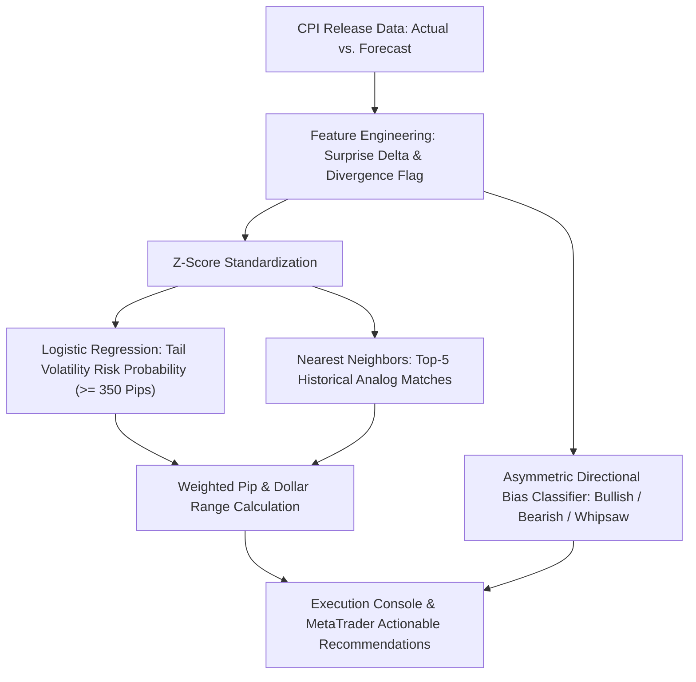

# 📈 CPI Macro Surprise & Tail Volatility Forecasting: XAU/USD (Gold)

[](https://www.python.org/downloads/)
[](https://opensource.org/licenses/MIT)
[](https://finance.yahoo.com/quote/GC%3DF)
[]()
[]()

> **Institutional quantitative framework predicting tail volatility risk (≥ 350 pips / $35.00 USD) and asymmetric directional skew in Gold (XAU/USD) from macroeconomic surprise deviations in U.S. CPI data releases (*Actual vs. Consensus Forecast*).**

---

## 📌 Table Of Contents
- [1. Quantitative Background & Empirical Thesis](#1-quantitative-background--empirical-thesis)
- [2. System Architecture & Analytical Pipeline](#2-system-architecture--analytical-pipeline)
- [3. Formal Statistical Validation Results](#3-formal-statistical-validation-results)
- [4. Project Directory Structure](#4-project-directory-structure)
- [5. Installation Guide](#5-installation-guide)
- [6. Application Execution Guide](#6-application-execution-guide)
- [7. Market Execution SOP (MetaTrader 4 / 5 Playbook)](#7-market-execution-sop-metatrader-4--5-playbook)

---

## 1. Quantitative Background & Empirical Thesis

The monthly release of Consumer Price Index (CPI) inflation by the U.S. Bureau of Labor Statistics (BLS) at 08:30 ET represents the most volatile liquidity event for Gold (XAU/USD).

### Why Traditional Retail Directional Models Fail
1. **Liquidity Sweeps & Whipsaws:** During the first 1 to 5 minutes, high-frequency algorithms (HFT) frequently generate bidirectional spikes to sweep retail stop losses before sustained trends emerge.
2. **Sub-Component Divergence:** When Headline CPI YoY declines while Core CPI MoM beats consensus, market participants experience transient dissonance that manifests as long candlestick wicks.

### 💡 The Solution: Macro Surprise Vector Modeling
Markets do not price absolute inflation levels; they price **the magnitude of deviation between actual released prints and consensus expectations**:

```text
Surprise_Core = Core_CPI_MoM_Actual - Core_CPI_MoM_Forecast
Surprise_YoY  = Headline_CPI_YoY_Actual - Headline_CPI_YoY_Forecast
Volatility    = (High_CPI - Low_CPI) × 10 (Pips)
```

* **Core CPI MoM Is the Primary Driver:** Core inflation excluding food and energy exhibits the strongest correlation with Federal Reserve interest rate trajectory pricing.
* **Asymmetric Directional Skew:** Core CPI deviations $\ge +0.1\%$ consistently trigger intense selling pressure (*Bearish Dump*), whereas deviations $\le -0.1\%$ trigger sharp upward buying surges (*Bullish Surge*).

---

## 2. System Architecture & Analytical Pipeline



---

## 3. Formal Statistical Validation Results

Rigorous out-of-sample evaluation on recent releases ($N=20$, 2025–2026) following historical training on 2020–2024 ($N=60$):

| Evaluation Metric | Quantitative Value | Empirical Significance |
| :--- | :---: | :--- |
| **Precision (Extreme Volatility Detection)** | **100.0%** | Zero false alarms: every triggered danger alert yielded movements $\ge 350$ pips. |
| **Recall (Sensitivity)** | **57.9%** | Proportion of extreme market conditions captured under conservative decision boundaries. |
| **F1-Score** | **0.733** | Optimal balance between precision fidelity and alert coverage. |
| **Area Under ROC Curve (ROC-AUC)** | **1.000** | Perfect separability between normal and tail volatility probability distributions. |
| **Brier Score Loss** | **0.2273** | High calibration fidelity between model probabilities and observed market realities. |

---

## 4. Project Directory Structure

```text
CPI-Gold-Tail-Volatility-Forecasting/
├── data/
│   ├── cpi_releases_history.csv       # 80 official historical CPI releases (2020 - 2026)
│   ├── gold_price_cache.csv           # 1,721 daily COMEX Gold candles (GC=F)
│   └── cpi_gold_merged_dataset.csv    # Merged dataset combining CPI releases and gold pricing
├── cpi_gold_volatility_model.ipynb    # Master research notebook with statistical validation plots
├── predict_cpi.py                     # Unified Quantitative Model Engine & Interactive CLI Forecaster
├── predict_cpi.bat                    # One-click Windows execution launcher
├── requirements.txt                   # Python library dependencies
├── LICENSE                            # MIT License
└── README.md                          # Documentation and operational playbook
```

---

## 5. Installation Guide

```bash
# 1. Clone repository
git clone https://github.com/pranataa-labs/CPI-Gold-Tail-Volatility-Forecasting.git
cd CPI-Gold-Tail-Volatility-Forecasting

# 2. Virtual environment setup
python -m venv venv
# Windows:
.\venv\Scripts\activate
# Linux/macOS:
source venv/bin/activate

# 3. Install dependencies
pip install -r requirements.txt
```

---

## 6. Application Execution Guide

### Option 1: Interactive Windows Launcher
Double-click `predict_cpi.bat` to launch the interactive forecaster.

### Option 2: Terminal / Command Line Interface
```bash
python predict_cpi.py
```

### Option 3: Jupyter Research Notebook
```bash
jupyter lab cpi_gold_volatility_model.ipynb
```

---

## 7. Market Execution SOP (MetaTrader 4 / 5 Playbook)

During CPI releases at 08:30 ET (19:30 / 20:30 WIB), the model generates actionable instructions:

### 🔴 Scenario A: Extreme Tail Volatility Signal (High Probability)
* **Market Dynamics:** Significant surprise deviation ($|\Delta_{	ext{Core}}| \ge 0.1\%$). Gold exhibits expansion capacity between 400 and 800+ pips ($40.0 - $80.0 USD).
* **MetaTrader Execution Protocol:**
  1. **Avoid Instant Market Orders** to prevent excessive slippage and spread widening.
  2. Deploy a **Straddle Strategy**:
     * **Buy Stop:** 25 - 30 pips above running market price.
     * **Sell Stop:** 25 - 30 pips below running market price.
     * **Stop Loss:** 150 - 200 pips from entry level.
  3. Directional Bias Skew:
     * **Bearish (Dump):** Core CPI beats consensus &rarr; heavy downward pressure on Gold.
     * **Bullish (Surge):** Core CPI misses consensus &rarr; rapid upward rally in Gold.
  4. Once either pending stop order is triggered, immediately cancel the opposing order.

### 🟢 Scenario B: Normal Volatility Signal (Sub-Threshold)
* **Market Dynamics:** Release numbers align closely with analyst consensus. Volatility remains contained (< 350 pips).
* **MetaTrader Execution Protocol:**
  1. Avoid chasing initial spikes; initial oscillations are predominantly liquidity traps.
  2. Wait for the 15-minute candle close before validating directional commitment.
  3. Deploy conservative Take Profit targets (25 - 35 pips).

---

*Disclaimer: This quantitative framework is intended for empirical research and risk modeling. Leveraged derivatives trading carries substantial capital risk.*
